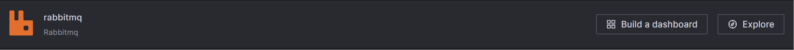
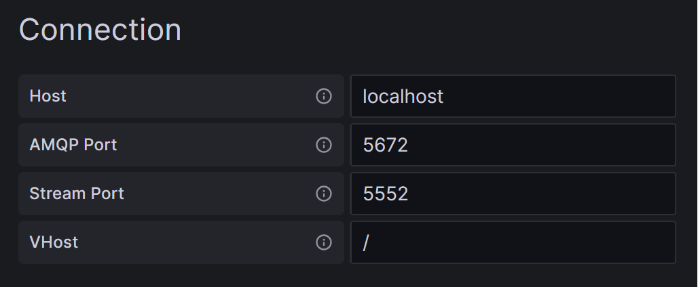
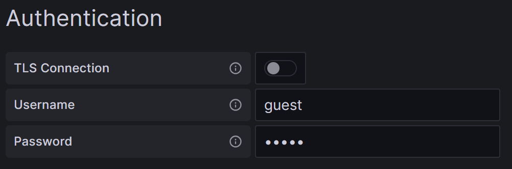
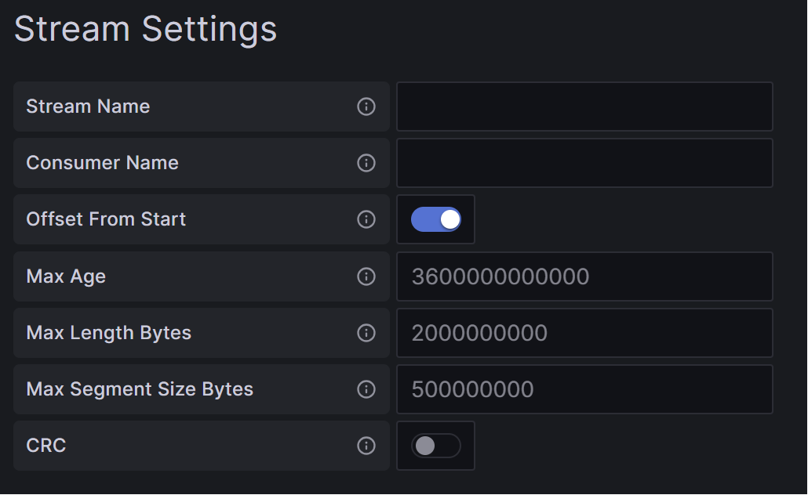
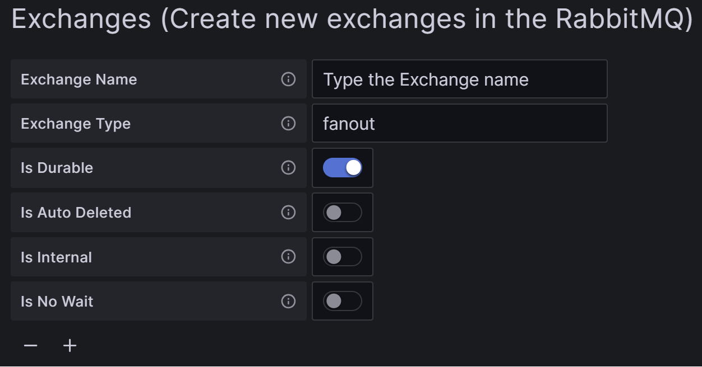
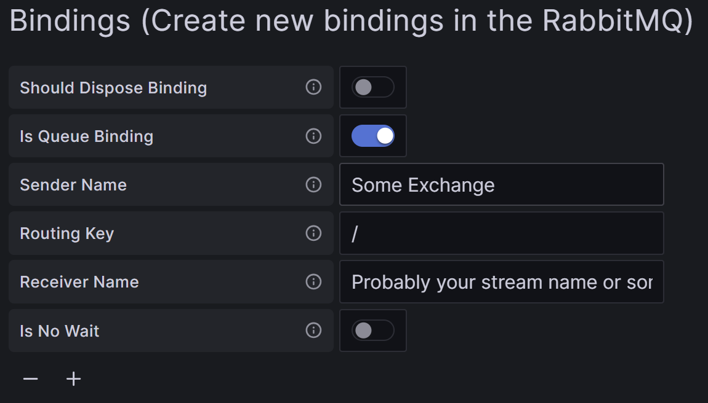
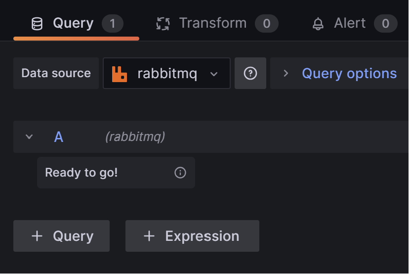

# RabbitMQ Grafana Datasource Plugin

The RabbitMQ Streaming Datasource plugin for realtime data updates in [Grafana](https://grafana.com) Dashboards.


## What is RabbitMQ Stream?
If you are not fimiliar with RabbitMQ Stream Plugin, here are some good resources to read from about it:
* [RabbitMQ official page about streams](https://www.rabbitmq.com/streams.html)
* [RabbitMQ Stream Core vs Stream Plugin](https://www.rabbitmq.com/stream-core-plugin-comparison.html)
* [RabbitMQ Stream Practical Guide Part 1](https://www.cloudamqp.com/blog/rabbitmq-streams-and-replay-features-part-1-when-to-use-rabbitmq-streams.html)
* [RabbitMQ Stream Practical Guide Part 2](https://www.cloudamqp.com/blog/rabbitmq-streams-and-replay-features-part-2-how-to-work-with-rabbitmq-streams.html)
* [RabbitMQ Stream Practical Guide Part 3](https://www.cloudamqp.com/blog/rabbitmq-streams-and-replay-features-part-3-limits-and-configurations-for-streams-in-rabbitmq.html)

## Getting Started
### Reqirements

- RabbitMQ v3.12.10+ with `rabbitmq_stream` plugin enabled (should work on RabbitMQ v3.9+ but never was tested)
- Grafana v13.2.0+

> Note: This is a backend plugin, so the Grafana server should've access to the RabbitMQ broker.

### Configuration Editor - Configure your RabbitMQ Stream


[Add a data source](https://grafana.com/docs/grafana/latest/datasources/add-a-data-source/) by filling in the following fields (**TIP**: if you are not sure some field means just leave it with the default value).

#### Connection
Basic connection section to connect the RabbitMQ.



| Field         | Type     | Is Required  | Default Value  | Description                                 |
|---------------|----------|--------------|----------------|---------------------------------------------|
| `Host`        | `string` | Yes          | `"localhost"`  | Hostname (or the IP) of the RabbitMQ server |
| `AMQP Port`   | `int`    | Yes          | `5672`         | The AMQP port of the RabbitMQ server        |
| `Stream Port` | `int`    | Yes      	  | `5552`         | The stream port of the RabbitMQ server      |
| `VHost`       | `string` | Yes       	  | `"/"`          | The virtual host the RabbitMQ server        |
---

#### Authentication
Basic authentication section to connect the RabbitMQ.



| Field                      | Type     | Is Required | Default Value | Description |
|----------------------------|----------|-------------|---------------|-------------|
| `TLS Connection`           | `bool`   | Yes         | `false`       | Use TLS for both the AMQP and the stream connection. Turning it on switches the default ports to `5671` (AMQP) and `5551` (stream) and shows the TLS Settings |
| `Authentication Mechanism` | `string` | Yes         | `PLAIN`       | `Username & password` (SASL PLAIN) or `Client certificate` (SASL EXTERNAL: the TLS client certificate identifies the user; requires `TLS Client Auth` and the `rabbitmq_auth_mechanism_ssl` plugin on the broker) |
| `Username`                 | `string` | With PLAIN  | `"guest"`     | Username to connect to the RabbitMQ server |
| `Password`                 | `string` | With PLAIN  | `"guest"`     | Password to connect to the RabbitMQ server (stored encrypted) |
---

#### TLS Settings
Shown when `TLS Connection` is on. The settings use Grafana's standard TLS keys (see the provisioning example below).

| Field             | Type     | Is Required          | Default Value | Description |
|-------------------|----------|----------------------|---------------|-------------|
| `Skip TLS Verify` | `bool`   | No                   | `false`       | Do not verify the server certificate. Insecure - only for testing |
| `Server Name`     | `string` | No                   | the host      | Name used to verify the server certificate (SNI), e.g. when connecting by IP |
| `Min TLS Version` | `string` | No                   | `1.2`         | Lowest accepted TLS version: `1.2` or `1.3` |
| `With CA Cert`    | `bool`   | No                   | `false`       | Verify the server with your own CA instead of the system root CAs |
| `CA Cert`         | PEM      | With `With CA Cert`  |               | CA certificate(s), PEM encoded (stored encrypted) |
| `TLS Client Auth` | `bool`   | No                   | `false`       | Present a client certificate (mutual TLS) |
| `Client Cert`     | PEM      | With `TLS Client Auth` |             | Client certificate, PEM encoded (stored encrypted) |
| `Client Key`      | PEM      | With `TLS Client Auth` |             | Private key of the client certificate, PEM encoded (stored encrypted) |

Provisioning example (mutual TLS with a private CA and client-certificate authentication):

```yaml
datasources:
  - name: RabbitMQ (TLS)
    type: maormil-rabbitmq-datasource
    jsonData:
      host: rabbitmq.example.com
      amqpPort: 5671
      streamPort: 5551
      tlsConnection: true
      saslMechanism: EXTERNAL   # or PLAIN with username + secureJsonData.password
      tlsAuthWithCACert: true
      tlsAuth: true
      tlsMinVersion: '1.2'
      # serverName: rabbitmq.internal
      # tlsSkipVerify: false
      streamOptions:
        streamName: rabbitmq.stream
    secureJsonData:
      tlsCACert: $__file{/etc/grafana/rabbitmq/ca.pem}
      tlsClientCert: $__file{/etc/grafana/rabbitmq/client.pem}
      tlsClientKey: $__file{/etc/grafana/rabbitmq/client-key.pem}
```
 
#### Stream Settings
Stream decleration settings section, where you define the settings of your wanted
RabbitMQ stream and the settings of its consumer.



| Field                    | Type     | Is Required | Default Value       | Description                                               |
|--------------------------|----------|-------------|---------------------|-----------------------------------------------------------|
| `Stream Name`            | `string` | Yes         | `"rabbitmq.stream"` | The stream name that will be created                      |
| `Consumer Name`          | `string` | No          | `""`                | The consumer name that will be created                    |
| `Offset from Start`      | `bool`   | Yes         | `true`              | Should the consumer consume messages from the start or the end of the stored messages in the stream |
| `Max Age`                | `int`    | Yes         | `3,600,000,000,000` | The max age of messages in the stream in nano-seconds (set to 0 to disable the max-age limit) |
| `Max Length Bytes`       | `int`    | Yes         | `2,000,000,000`     | The max length of messages in bytes in the stream (set to 0 to disable the max-length-bytes limit) |
| `Max Segment Size Bytes` | `int`    | Yes         | `500,000,000`       | The max segment size in bytes in the stream               |
| `CRC`                    | `bool`   | Yes         | `false`             | When CRC control is disabled, the perfomance is increased |
---

#### Exchanges
Optional Section.
Array section for multiple exchanges that should be created in the RabbitMQ (they are declared again whenever the plugin reconnects, e.g. after a connection loss or a stream deletion in the RabbitMQ).
If the exchange already exists in the RabbitMQ, the plugin will not recreate the exchange but if the same exchange name already exists in the RabbitMQ with different settings that you gave, you might encounter some problems creating the RabbitMQ Datasource connections.



| Field                     | Type     | Is Required | Default Value              | Description                                                          |
|---------------------------|----------|-------------|----------------------------|----------------------------------------------------------------------|
| `Exchange Name`           | `string` | Yes         | `"rabbitmq.exchange"`          | The exchange name that should exist in the RabbitMQ                  |
| `Exchange Type`           | `string` | Yes         | `"fanout"`                   | The exchange type                                                    |
| `Is Durable`              | `bool`   | Yes         | `true`                     | Should the exchange be durable                                       |
| `Is Auto Deleted`         | `bool`   | Yes         | `false`                    | Should the exchange be auto deleted                                  |
| `Is Internal`             | `bool`   | Yes         | `false`                    | Should the exchange be internal                                      |
| `Is NoWait`               | `bool`   | Yes         | `false`                    | Should the exchange be noWait                                        |
---

#### Bindings
Optional Section.
Array section for multiple bindings that should be created in the RabbitMQ (they will also be recreated in case of connection lost to the RabbitMQ / Stream deletion in the RabbitMQ).
If the binding already exists in the RabbitMQ, the plugin will not recreate the binding.
There is a support of binding of exchange to queue (or a stream) type of binding AND binding of exchange to exchange.



| Field                    | Type     | Is Required | Default Value                                          | Description                                              |
|--------------------------|----------|-------------|--------------------------------------------------------|----------------------------------------------------------|
| `Is Queue Binding`       | `bool`   | Yes         | `true`                                                 | Should binding be from Exchange to queue/stream (if disabled, the binding will be from exchange to exchange) |
| `Sender Name`            | `string` | Yes         | `"rabbitmq.exchange"`                                      | The exchange to bind from                                |
| `Routing Key`            | `string` | Yes         | `"/"`                                                  | The routing key to bind between the sender exchange and the receiver |
| `Receiver Name`          | `string` | Yes         | `"rabbitmq.stream"` | The stream/queue/exchange to bind to                     |
| `Is No Wait`             | `bool`   | Yes         | `false`                                                | Should binding be noWait                                 |
---

## Query Editor


Please pay attention that there is no real query editor in the RabbitMQ plugin.
Once you set the datasource settings you ready to go.
You can still change the time range query in the default Grafana query editor which will impact what data is being showen and how fast the query interval is.
This plugin was planned and deisgned to work with the [Plotly by nline](https://github.com/nline/nline-plotlyjs-panel) panel plugin.
Feel free to check this awesome plugin (and if you wish not to use plotly you can still use transformations together with this RabbitMQ plugin).

## Reconnecting to the RabbitMQ
The plugin handles most chaos scenarios automatically:
* If the stream is deleted in the RabbitMQ itself - the stream and the pre-configured exchanges and bindings are declared again and streaming resumes (the messages that were stored in the deleted stream are gone).
* If the connection to the RabbitMQ is lost (broker restart, network issue) - Grafana restarts the stream with an exponential backoff while a panel is open, and the plugin reconnects.
* If the Grafana is down - the consumer is recreated once a panel is opened again.

The consumer is created when a panel that uses the RabbitMQ datasource is opened, and closed (together with its connection) shortly after the last such panel is closed.

## The plugin never deletes anything in the RabbitMQ
The plugin declares the configured stream, exchanges and bindings (declaring is idempotent, so existing objects with the same settings are reused), but it never deletes them - not when a dashboard is closed, not when the datasource settings are saved, and not when the datasource is deleted (Grafana does not tell plugins about deletions).
Delete objects you no longer need in the RabbitMQ itself (e.g. with the management UI or `rabbitmqctl`), and use `Max Age` / `Max Length Bytes` to bound how much the stream keeps.
Versions before 2.0.0 had "Should Dispose ..." settings that deleted these objects - often unexpectedly, e.g. whenever the last panel was closed. They were removed; old values in saved datasources are ignored.

## Known limitations
* This plugin only supports JSON based messages that and throws away any non JSON message. The JSON can contain numbers, strings, booleans, and JSON formatted values. Nested object values can be extracted using the Extract Fields transformation (or being processed by the [Plotly by nline](https://github.com/nline/nline-plotlyjs-panel) panel plugin).
* **This plugin automatically attaches timestamps to the messages** when they are received. Timestamps included in the message body can be parsed using the Convert field type transformation. **The key name of the added timestamp is: `RmqMsgConsumedTimestamp`**
* Currently the only supported offsets are First and Last (no specific offset or timestamp support when consuming messages from the RabbitMQ streams).

## Known Errors and Causes When Trying To Connect To RabbitMQ

* `dial tcp <ip/hostname>:<port>: connect: connection refused`
   * There is no RabbitMQ up with the given `<ip/hostname>`.
   * Wrong `Stream Port`.


* `timeout 10000 ms - waiting Code, operation: commandPeerProperties`
    * The Stream Plugin is not enabled in the RabbitMQ.
    * Wrong `AMQP Port`.
    * Wrong `VHost`.


* There could be more errors, but the rest of them are pretty intuitive.

## Credits
### Creating the actual Streaming Backend Plugin
The streaming feature in Grafana is still experimental and the documntation to how to create a streaming backend datasource is lacking.
There are not a lot of plugins that support this feature yet, so in order to create this RabbitMQ Datasource plugin I read and used some parts from all of the existing Grafana Streaming Datasources:
* [MQTT Datasource (by GrafanaLabs)](https://github.com/grafana/mqtt-datasource/)
* [Kafka Datasource (by hamedkarbasi93)](https://github.com/hoptical/grafana-kafka-datasource)
* [Websocket Backend Datasource Example (by GrafanaLabs)](https://github.com/grafana/grafana-plugin-examples/tree/main/examples/datasource-streaming-backend-websocket)
* [Websocket Datasource (by Golioth)](https://github.com/golioth/grafana-websocket-plugin)

Speical credit for the framer.go which was copied from the MQTT Datasource and modified a little bit.

### Communication with the RabbitMQ
The plugin is using 2 main core packages to be able to communicate with the RabbitMQ, both by the [RabbitMQ core team](https://github.com/rabbitmq):
* [amqp091-go](https://github.com/rabbitmq/amqp091-go)
* [rabbitmq-stream-go-client](https://github.com/rabbitmq/rabbitmq-stream-go-client)

## Development

Prerequisites: Node.js 24 (see `.nvmrc`), Go (version from `go.mod`, the Go toolchain downloads it automatically), [Mage](https://magefile.org/) and Docker.

```bash
npm install          # install frontend dependencies
npm run dev          # build the frontend in watch mode (or `npm run build` for production)
mage -v build:linux  # build the backend binary that the Grafana container runs (use `mage -v buildAll` for every platform)
npm run server       # start Grafana (http://localhost:3000) and RabbitMQ (management UI on http://localhost:15672, guest/guest)
go run ./demo        # publish random JSON messages into the provisioned stream
```

Checks (the same ones CI runs):

```bash
npm run typecheck && npm run lint && npm run test:ci && npm run build
mage -v buildAll && mage coverage
npx playwright install chromium   # once
npm run e2e                       # requires `npm run server` to be up
```

The E2E tests (`tests/`, [`@grafana/plugin-e2e`](https://grafana.com/developers/plugin-tools/e2e-test-a-plugin/) + Playwright) run against the real Grafana and RabbitMQ containers. Each streaming test creates its own data source, stream and dashboard (see `tests/fixtures.ts`) and publishes messages through the RabbitMQ management API (`tests/helpers/rabbitmq.ts`). Bugs the suite reproduces are listed in `tests/known-bugs.ts`; their tests are marked as expected failures until the bug is fixed.

The plugin was scaffolded with [`@grafana/create-plugin`](https://grafana.com/developers/plugin-tools/); update it with `npx @grafana/create-plugin@latest update` (on Windows run it from WSL or a `node:24` container, since the CLI does not support Windows).

## Contributing

Thank you for considering contributing! If you find an issue or have a better way to do something, feel free to open an issue or a PR.

## License

This repository is open-sourced software licensed under the [Apache License 2.0](https://www.apache.org/licenses/LICENSE-2.0).